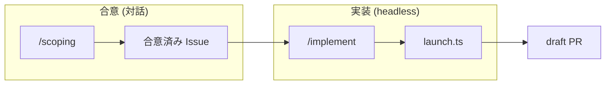

# Commands

コマンドの実装と、`/scoping` → `/implement` を中心とした開発フロー。

📌 [English version](../../docs/COMMANDS.md)

## 開発フロー全体

要求と完了条件は人間が `/scoping` で対話して Issue に合意し、実装は `/implement` が呼ぶ `launch.ts` が headless で draft PR まで進める。機能追加とバグ修正は同じ経路を通る。

Issue を経ない変更は `/sweep`、`/dr`、`/outcome` が自分で draft PR まで公開する。

## /implement

`/implement <Issue 番号>` が起動前に確認し、`skills/implement/scripts/launch.ts` を呼ぶ。対象 repo の root には `repository`、`remote`、`baseBranch`、`setup`、`check`、`ciChecks`、`capture` を持つ `.dotagents.json` が要る。

| Phase     | 内容                                                                                |
| --------- | ----------------------------------------------------------------------------------- |
| Target    | `.dotagents.json` と Issue を読み、実行の対象を確かめる                             |
| Prepare   | 隔離 worktree を用意し `setup` を走らせる                                           |
| Implement | 1 回の実装パス                                                                      |
| Verify    | capture、check、独立レビュー、修正を、レビューが受け入れられるまで繰り返す          |
| Ship      | `/implement` が 1 回コミットし、`launch.ts` が push し、draft PR を開く             |
| CI        | 同じ head で CI を待つ。ready への切り替えは `/implement` skill と人間が受け持つ    |

## Command → 実装マッピング

skill は SKILL.md の手順を会話の文脈で実行する。`/implement` は、ループとゲートを持つ処理を `launch.ts` に置き、LLM の裁量で飛ばせない形にする。

| コマンド     | 実装                        | 形態                                |
| ------------ | --------------------------- | ----------------------------------- |
| `/scoping`   | `skills/scoping/SKILL.md`   | skill (合意した範囲を Issue にする) |
| `/implement` | `skills/implement/SKILL.md` | skill (`launch.ts` を呼ぶ)          |

## 関連

- [SKILLS_AGENTS.md](./SKILLS_AGENTS.md). Skill とエージェントのリファレンス
- [DESIGN.md](./DESIGN.md). レイヤー構造と設計哲学
