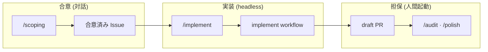

# Commands & Workflows

コマンドと workflow の関係、および `/scoping` → `/implement` を中心とした開発フロー。

📌 [English version](../../docs/COMMANDS.md)

## 開発フロー全体

要求と完了条件は人間が `/scoping` で対話して Issue に合意し、実装は implement workflow が headless で進め、重い担保は draft PR に対して人間が起動する。機能追加とバグ修正は同じ経路を通る。

Issue を経ない変更は `/sweep`、`/dr`、`/outcome`、`/scribe` が自分で draft PR まで公開する。

## implement workflow

`/implement <Issue 番号>` が起動前に確認し、workflow を host (`workflows/_lib/claude-run.ts`) で起動する。対象 repo の root には `repository`、`remote`、`baseBranch`、`setup`、`check`、`ciChecks`、`capture` を持つ `.dotagents.json` が要る。

| Phase     | 内容                                                                                |
| --------- | ----------------------------------------------------------------------------------- |
| Target    | `.dotagents.json` と Issue を読み、実行の対象を確かめる                             |
| Prepare   | 隔離 worktree を用意し `setup` を走らせる                                           |
| Implement | 1 回の実装パス                                                                      |
| Verify    | capture、check、独立レビュー、修正を、レビューが受け入れられるまで繰り返す          |
| Ship      | 1 回コミットし、push し、draft PR を開く                                            |
| CI        | 同じ head で CI を待つ。ready への切り替えは `/implement` skill と人間が受け持つ    |

### 統治する DR

| DR                                                                                                                  | 決定                                                                 |
| ------------------------------------------------------------------------------------------------------------------- | -------------------------------------------------------------------- |
| [DR-0120](../../docs/decisions/0120-keep-the-implement-workflows-deviations-from-codexs-implement.md)               | implement workflow が Codex の implement から外れるところを保つ      |
| [DR-0127](../../docs/decisions/0127-launch-the-implement-workflow-on-a-host-that-runs-relays-itself.md)             | relay を自分で走らせる host から implement workflow を起動する       |
| [DR-0128](../../docs/decisions/0128-retire-the-plan-based-build-path-for-scoping-and-implement.md)                  | Issue から PR までの経路を `/scoping` → `/implement` の 1 本にする   |
| [DR-0090](../../docs/decisions/0090-unify-workspace-and-history-storage-locations.md)                               | 成果物は `.claude/workspace/`、履歴は `~/.claude/history/`           |

## Workflow 一覧

入れ子は assert が audit を呼ぶ 1 経路だけ。他は単体起動する。

| Workflow  | 役割                                                      | 主な nested agent                                   |
| --------- | --------------------------------------------------------- | --------------------------------------------------- |
| implement | 合意済み Issue の実装から draft PR と CI 確認まで         | 実装、レビュー、修正、命名の `claude -p` セッション |
| audit     | diff への adversarial review fan-out                      | file-routed reviewer、critic-audit、critic-evidence |
| polish    | Codex 外部レンズの review + cleanup                       | critic-audit、enhancer-code                         |
| assert    | merge readiness の独立判定 (Codex を隔離 worktree で並走) | codex、critic 層                                    |
| shake     | flaky テストの 4 次元検出と根本修正                       | 実行 agent、静的 smell scan                         |
| adrift    | DR と現行コードの乖離スキャン                             | manifest-routed reviewer                            |

## Command → 実装マッピング

skill は SKILL.md の手順を会話の文脈で実行し、workflow はスクリプトが進行を強制する。fan-out、ループ、ゲートを持つ処理は workflow に置き、LLM の裁量で飛ばせない形にする ([WORKFLOWS](../rules/conventions/WORKFLOWS.md))。

| コマンド     | 実装                        | 形態                                  |
| ------------ | --------------------------- | ------------------------------------- |
| `/scoping`   | `skills/scoping/SKILL.md`   | skill (合意した範囲を Issue にする)   |
| `/implement` | `skills/implement/SKILL.md` | skill (implement workflow を起動する) |
| `/audit`     | `workflows/audit.js`        | workflow                              |
| `/polish`    | `workflows/polish.js`       | workflow                              |

## 関連

- [SKILLS_AGENTS.md](./SKILLS_AGENTS.md). Skill とエージェントのリファレンス
- [DESIGN.md](./DESIGN.md). レイヤー構造と設計哲学
