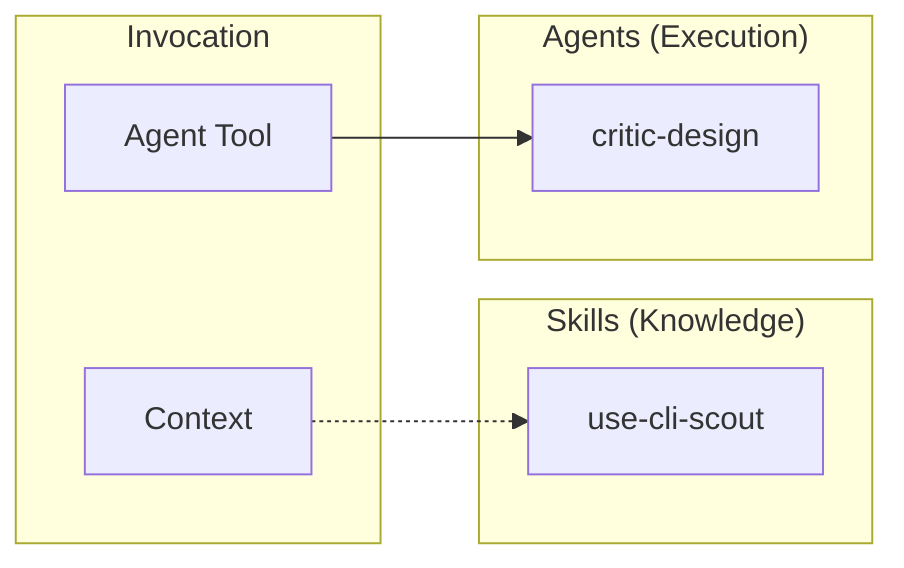
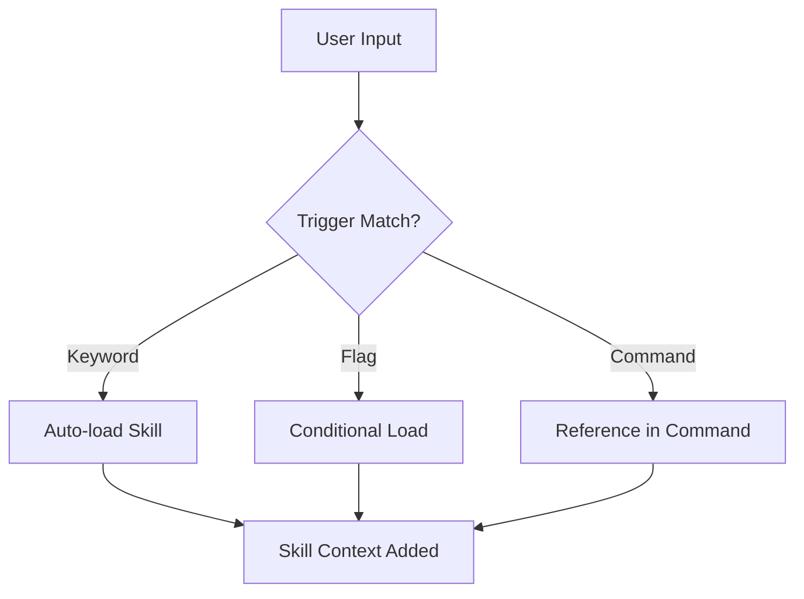

# Skills & Agents Design

Skill とエージェントの設計意図と利用ガイドライン。

📌 [English version](../../docs/SKILLS_AGENTS.md)

## コアコンセプト



## Skills と Agents

`dr` は DR file と index を Write/Edit で生成し、`implement` は implement workflow を起動する。そのため Skill の状態と出力は許可ツールと手順に依存する。

| 観点         | Skills                              | Agents           |
| ------------ | ----------------------------------- | ---------------- |
| 役割         | ナレッジベースまたは手順 (What/How) | 実行者 (Do)      |
| 起動         | 自動ロードまたはコマンド参照        | Agent ツール経由 |
| コンテキスト | メイン または fork                  | 常に fork        |
| 状態         | 読み取りまたは変更                  | 可変             |
| 出力         | 情報、ファイル、または実行結果      | アーティファクト |

## Skills

### 用途

Skills は「ナレッジモジュール」。AI がタスク実行時にドメイン固有の知識を提供する。

### カテゴリ

User-invocable Skills は下表の 5 件。

| カテゴリ       | Skills                                         | 用途                     |
| -------------- | ---------------------------------------------- | ------------------------ |
| CLI ラッパー   | use-cli-recall, use-cli-scout                  | CLI ツール統合           |
| User-invocable | dr, implement, outcome, scoping, sweep         | スラッシュコマンドの入口 |

### ロード機構



#### トリガー例

| トリガー                      | ロードされる Skill |
| ----------------------------- | ------------------ |
| "web search", "release notes" | use-cli-scout      |

### ファイル構造

```text
skills/[skill-name]/
├── SKILL.md        # 必須: YAML frontmatter + 知識本体
└── references/     # 任意: 詳細ガイド
    └── *.md
```

### YAML Frontmatter

```yaml
---
name: use-cli-scout
description: Web search, page fetch, and GitHub repo exploration via scout CLI.
when_to_use: web search, page fetch, release notes, 最新ドキュメント
allowed-tools: Bash(scout:*) Read
user-invocable: false # スラッシュコマンドとして起動可能か
---
```

## Agents

### 用途

エージェントは「専門実行者」。Agent ツール経由で起動し、特定の分析や生成タスクを自律的に行う。

### カテゴリ

```text
agents/
└── critics/        # 反論検証 (critic-design)
```

### Agent ツールでの起動

```markdown
Agent tool で:

- subagent_type: "critic-design"
- prompt: "Attack this design proposal for hidden assumptions and costs"
- model: "sonnet" (任意)
```

## 設計判断

### Skill と Agent を分ける理由

| 理由             | 説明                                                 |
| ---------------- | ---------------------------------------------------- |
| 関心の分離       | 知識 (Skills) と実行 (Agents) を分離                 |
| コンテキスト管理 | エージェントは fork で動き、メインの文脈を汚染しない |
| 再利用性         | Skill は複数のコマンドから参照できる                 |
| 専門化           | エージェントは特定タスクに特化し、より深い分析を行う |

### 参照深度ルール

```text
SKILL.md → reference.md (1 階層のみ)
```

理由: 階層が増えるほど読むファイルが増え、参照グラフも追いにくくなる。

## 関連

- [COMMANDS.md](./COMMANDS.md). コマンドと workflow の関係、`/scoping` → `/implement` 中心の開発フロー
- [SKILLS](../rules/conventions/SKILLS.md). Skill 定義書式
- [SUBAGENT](../rules/conventions/SUBAGENT.md). サブエージェント定義書式
