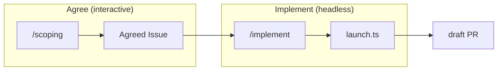

# Commands

How the commands are implemented, and the development flow centered on `/scoping` → `/implement`.

📌 [日本語版](../.ja/docs/COMMANDS.md)

## The Development Flow

Humans settle the requirements and done conditions with `/scoping` until an Issue is agreed, and `launch.ts`, which `/implement` calls, implements it headlessly up to a draft PR. A feature and a bug fix take the same path.

A change with no Issue is published up to a draft PR by `/sweep`, `/dr`, or `/outcome` themselves.

## /implement

`/implement <Issue number>` runs the checks before launch and calls `skills/implement/scripts/launch.ts`. The target repository's root needs a `.dotagents.json` carrying `repository`, `remote`, `baseBranch`, `setup`, `check`, `ciChecks`, and `capture`.

| Phase     | Content                                                                                    |
| --------- | ------------------------------------------------------------------------------------------ |
| Target    | Read `.dotagents.json` and the Issue, and confirm what the run targets                     |
| Prepare   | Cut an isolated worktree and run `setup`                                                   |
| Implement | One implementation pass                                                                    |
| Verify    | Capture, check, independent review, and repair, repeated until the review is accepted      |
| Ship      | `/implement` commits once, and `launch.ts` pushes and opens a draft PR                     |
| CI        | Wait for CI on the same head. The switch to ready stays with the `/implement` skill and the human |

### Governing DRs

| DR                                                                                                | Decision                                                                    |
| ------------------------------------------------------------------------------------------------- | --------------------------------------------------------------------------- |
| [DR-0120](decisions/0120-keep-the-implement-workflows-deviations-from-codexs-implement.md)        | Keep the implement workflow's deviations from Codex's implement             |
| [DR-0127](decisions/0127-launch-the-implement-workflow-on-a-host-that-runs-relays-itself.md)      | Launch the implement workflow on a host that runs relays itself             |
| [DR-0128](decisions/0128-retire-the-plan-based-build-path-for-scoping-and-implement.md)           | One path from an Issue to a PR: `/scoping` → `/implement`                   |
| [DR-0090](decisions/0090-unify-workspace-and-history-storage-locations.md)                        | Work products live in `.claude/workspace/`, records in `~/.claude/history/` |

## Command → Implementation Mapping

A skill executes its SKILL.md procedure in the conversation context. `/implement` puts the processing that carries loops and gates into `launch.ts`, in a shape the LLM cannot skip at its discretion.

| Command      | Implementation              | Form                                         |
| ------------ | --------------------------- | -------------------------------------------- |
| `/scoping`   | `skills/scoping/SKILL.md`   | Skill (turns the agreed scope into an Issue) |
| `/implement` | `skills/implement/SKILL.md` | Skill (calls `launch.ts`)                    |

## Related

- [SKILLS_AGENTS.md](./SKILLS_AGENTS.md). Skill and agent reference
- [DESIGN.md](./DESIGN.md). Layer structure and design philosophy
