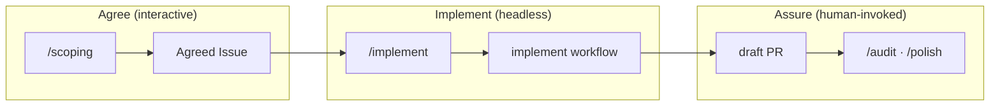

# Commands & Workflows

How commands and workflows relate, and the development flow centered on `/scoping` → `/implement`.

📌 [日本語版](../.ja/docs/COMMANDS.md)

## The Development Flow

Humans settle the requirements and done conditions with `/scoping` until an Issue is agreed, the implement workflow implements it headlessly, and heavy assurance is human-invoked on the draft PR. A feature and a bug fix take the same path.

A change with no Issue is published up to a draft PR by `/sweep`, `/dr`, `/outcome`, or `/scribe` themselves.

## implement workflow

`/implement <Issue number>` runs the checks before launch and launches the workflow on the host (`workflows/_lib/claude-run.ts`). The target repository's root needs a `.dotagents.json` carrying `repository`, `remote`, `baseBranch`, `setup`, `check`, `ciChecks`, and `capture`.

| Phase     | Content                                                                                    |
| --------- | ------------------------------------------------------------------------------------------ |
| Target    | Read `.dotagents.json` and the Issue, and confirm what the run targets                     |
| Prepare   | Cut an isolated worktree and run `setup`                                                   |
| Implement | One implementation pass                                                                    |
| Verify    | Capture, check, independent review, and repair, repeated until the review is accepted      |
| Ship      | Commit once, push, and open a draft PR                                                     |
| CI        | Wait for CI on the same head. The switch to ready stays with the `/implement` skill and the human |

### Governing DRs

| DR                                                                                                | Decision                                                                    |
| ------------------------------------------------------------------------------------------------- | --------------------------------------------------------------------------- |
| [DR-0120](decisions/0120-keep-the-implement-workflows-deviations-from-codexs-implement.md)        | Keep the implement workflow's deviations from Codex's implement             |
| [DR-0127](decisions/0127-launch-the-implement-workflow-on-a-host-that-runs-relays-itself.md)      | Launch the implement workflow on a host that runs relays itself             |
| [DR-0128](decisions/0128-retire-the-plan-based-build-path-for-scoping-and-implement.md)           | One path from an Issue to a PR: `/scoping` → `/implement`                   |
| [DR-0090](decisions/0090-unify-workspace-and-history-storage-locations.md)                        | Work products live in `.claude/workspace/`, records in `~/.claude/history/` |

## Workflow Roster

The one nesting is assert calling audit. The others launch standalone.

| Workflow  | Role                                                                | Main nested agents                                               |
| --------- | ------------------------------------------------------------------- | ---------------------------------------------------------------- |
| implement | From an agreed Issue's implementation to a draft PR and CI          | `claude -p` sessions for implementing, reviewing, repairing, naming |
| audit     | Adversarial review fan-out over a diff                              | File-routed reviewers, critic-audit, critic-evidence             |
| polish    | External-lens (Codex) review + cleanup                              | critic-audit, enhancer-code                                      |
| assert    | Independent merge-readiness verdict (Codex in an isolated worktree) | codex, critic layer                                              |
| shake     | 4-dimension flaky-test detection and root-cause fix                 | Runner agents, static smell scan                                 |
| adrift    | Drift scan between DRs and current code                             | Manifest-routed reviewers                                        |

## Command → Implementation Mapping

A skill executes its SKILL.md procedure in the conversation context; a workflow's script enforces progression. Processing that carries fan-out, loops, or gates goes into a workflow, in a shape the LLM cannot skip at its discretion ([WORKFLOWS](../rules/conventions/WORKFLOWS.md)).

| Command      | Implementation              | Form                                       |
| ------------ | --------------------------- | ------------------------------------------ |
| `/scoping`   | `skills/scoping/SKILL.md`   | Skill (turns the agreed scope into an Issue) |
| `/implement` | `skills/implement/SKILL.md` | Skill (launches the implement workflow)    |
| `/audit`     | `workflows/audit.js`        | Workflow                                   |
| `/polish`    | `workflows/polish.js`       | Workflow                                   |

## Related

- [SKILLS_AGENTS.md](./SKILLS_AGENTS.md). Skill and agent reference
- [DESIGN.md](./DESIGN.md). Layer structure and design philosophy
