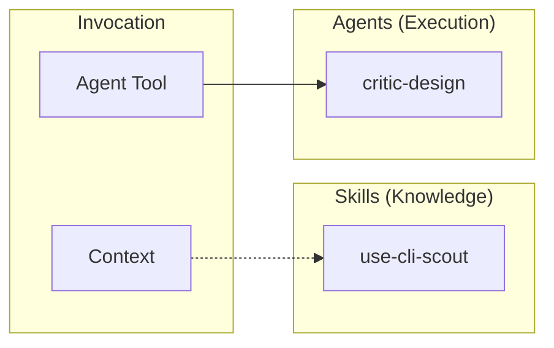
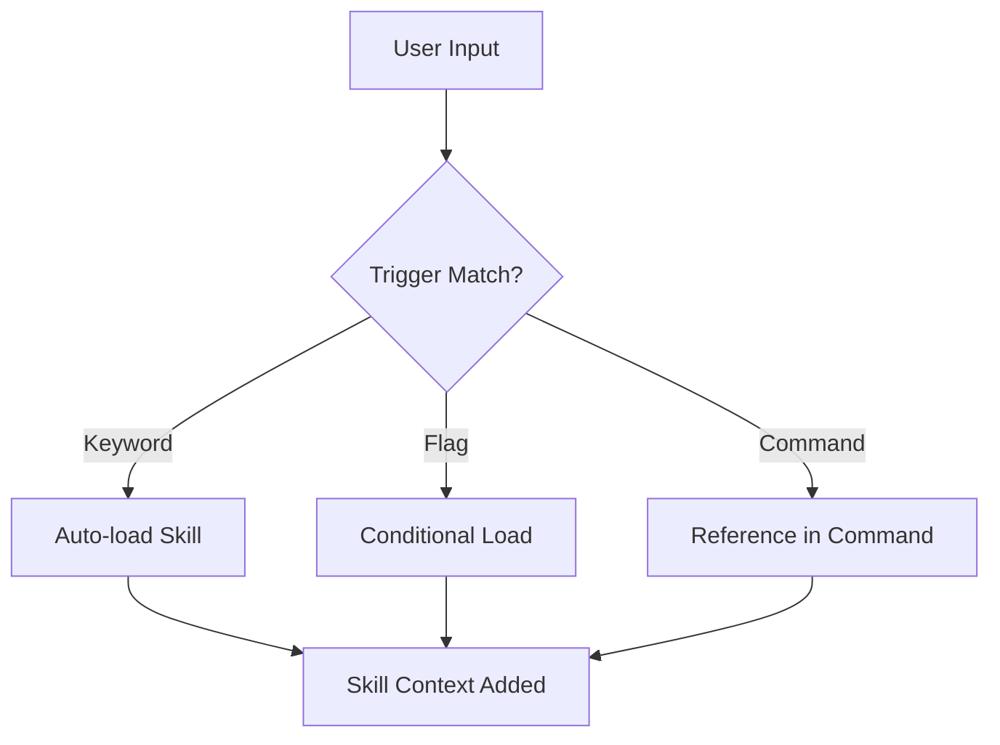

# Skills & Agents Design

Design intent and usage guidelines for Skills and Agents.

📌 **[日本語版](../.ja/docs/SKILLS_AGENTS.md)**

## Core Concept



## Skills vs Agents

`dr` creates a DR file and index through Write/Edit, and `implement` launches
the implement workflow. Skill state and output therefore depend on the permitted tools and
procedure.

| Aspect         | Skills                         | Agents         |
| -------------- | ------------------------------ | -------------- |
| **Role**       | Knowledge base or procedure    | Executor (Do)  |
| **Invocation** | Auto-load or command reference | Via Agent tool |
| **Context**    | Main or fork                   | Always fork    |
| **State**      | Read-only or mutable           | Mutable        |
| **Output**     | Information, files, or actions | Artifacts      |

## Skills

### Purpose

Skills are "knowledge modules" that provide domain-specific knowledge when AI executes tasks.

### Categories

The User-invocable row lists all 6 current Skills.

| Category       | Skills                                         | Purpose                    |
| -------------- | ---------------------------------------------- | -------------------------- |
| CLI wrapper    | use-cli-recall, use-cli-scout, use-cli-gcloud  | CLI tool integration       |
| User-invocable | dr, implement, outcome, scoping, scribe, sweep | Slash command entry points |

### Loading Mechanism



#### Trigger Examples

| Trigger                       | Skill Loaded  |
| ----------------------------- | ------------- |
| "web search", "release notes" | use-cli-scout |

### File Structure

```text
skills/[skill-name]/
├── SKILL.md        # Required: YAML front matter + knowledge body
└── references/     # Optional: detailed guides
    └── *.md
```

### YAML Front Matter

```yaml
---
name: use-cli-scout
description: Web search, page fetch, and GitHub repo exploration via scout CLI.
when_to_use: web search, page fetch, release notes, 最新ドキュメント
allowed-tools: Bash(scout:*) Read
user-invocable: false # Whether invocable as slash command
---
```

## Agents

### Purpose

Agents are "specialized executors" spawned via the Agent tool to autonomously
perform specific analysis or generation tasks.

### Categories

```text
agents/
└── critics/        # Critical verification (critic-design)
```

### Invocation via Agent Tool

```markdown
Agent tool with:

- subagent_type: "critic-design"
- prompt: "Attack this design proposal for hidden assumptions and costs"
- model: "sonnet" (optional)
```

## Design Decisions

### Why Separate Skills and Agents?

| Reason                     | Explanation                                             |
| -------------------------- | ------------------------------------------------------- |
| **Separation of Concerns** | Separate knowledge (Skills) from execution (Agents)     |
| **Context Management**     | Agents run in fork, don't pollute main context          |
| **Reusability**            | Skills can be referenced from multiple commands         |
| **Specialization**         | Agents specialize in specific tasks for deeper analysis |

### Reference Depth Rule

```text
SKILL.md → reference.md (1 level only)
```

Reason: each extra level adds files to read and makes the reference graph harder to follow.

## Related

- [COMMANDS.md](./COMMANDS.md) - Commands, workflows, and the development flow centered on `/scoping` → `/implement`
- [SKILLS](../rules/conventions/SKILLS.md) - Skill definition format
- [SUBAGENT](../rules/conventions/SUBAGENT.md) - Sub-agent definition format
